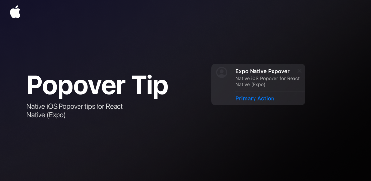

<p align="center">
  
</p>

<p align="">
  A sleek native iOS popover tooltip component for React Native via Expo Modules
</p>

---

## ✨ Features

- 💬 Supports **actionable tooltips** with buttons
- 🧊 Seamless glass morphism with blur and symbol support
- 🔁 Custom dismiss & tap handlers for interactive UIs
- 🧩 Nest **React Native children** inside your popover tip
- ⚡️ High performance via **Expo Modules Core**

---

## 🚀 Installation

```bash
bunx expo install expo-ios-popover-tip
```

Then:

```bash
cd ios && pod install
```

> 💡 Requires Expo SDK 53+ and `expo prebuild --platform ios`

---

## 🧪 Usage

```tsx
import React, { useEffect, useState } from "react";
import { View, Text, StyleSheet } from "react-native";
import { SymbolView } from "expo-symbols";
import {
  ToolTipView,
  resetTips,
  configureTips,
  isConfigured,
} from "expo-ios-popover-tip";

export const Home = () => {
  const [isTipReady, setIsTipReady] = useState<boolean>(false);
  useEffect(() => {
    resetTips();
    configureTips();

    isConfigured().then(() => setIsTipReady(true));
  }, []);

  return (
    <View style={styles.container}>
      <ToolTipView
        tooltip={{
          id: "onboarding_tip",
          title: { text: "Welcome!" },
          description: { text: "Tap this to begin." },
          actions: [{ id: "start", title: "Let’s go!" }],
        }}
        isVisible={isTipReady}
      >
        <View style={styles.button}>
          <SymbolView name="info.circle" size={15} tintColor="#fff" />
          <Text style={styles.buttonText}>Home Screen</Text>
        </View>
      </ToolTipView>
    </View>
  );
};

const styles = StyleSheet.create({
  container: {
    flex: 1,
    backgroundColor: "#fff",
    alignItems: "center",
    justifyContent: "center",
  },
  button: {
    backgroundColor: "#000",
    padding: 10,
    borderRadius: 18,
    alignItems: "center",
    gap: 10,
    paddingHorizontal: 20,
    flexDirection: "row",
  },
  buttonText: {
    color: "#fff",
    fontWeight: "600",
  },
});
```

---

## 🧭 Sequential Tips (Tip Queue)

You can show multiple tips one after another.

- Please check out [this example](./example/src/screens/Home.tsx)

---

## 🎥 Demo

https://github.com/user-attachments/assets/c2b0e8cf-0814-40f2-b36a-66825313a6df

---

## ❤️ Contributing

Pull requests and feedback are warmly welcome!
Let’s push the limits of native + React Native.

---

## 📄 License

MIT © [rit3zh](https://github.com/rit3zh)
